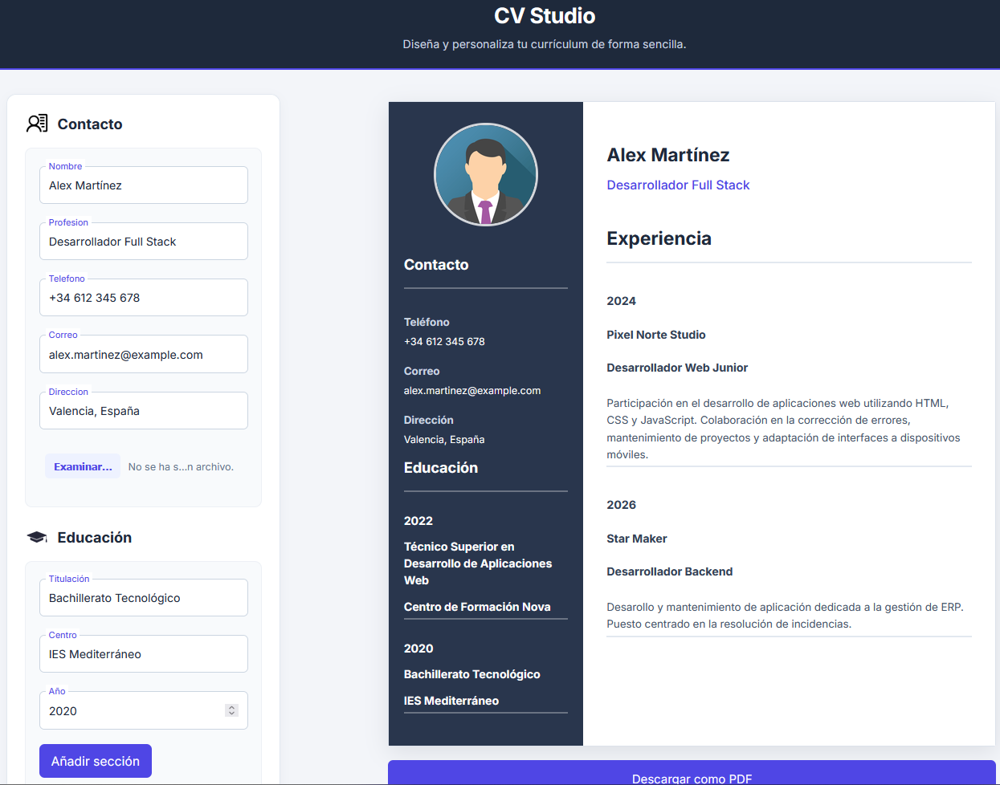
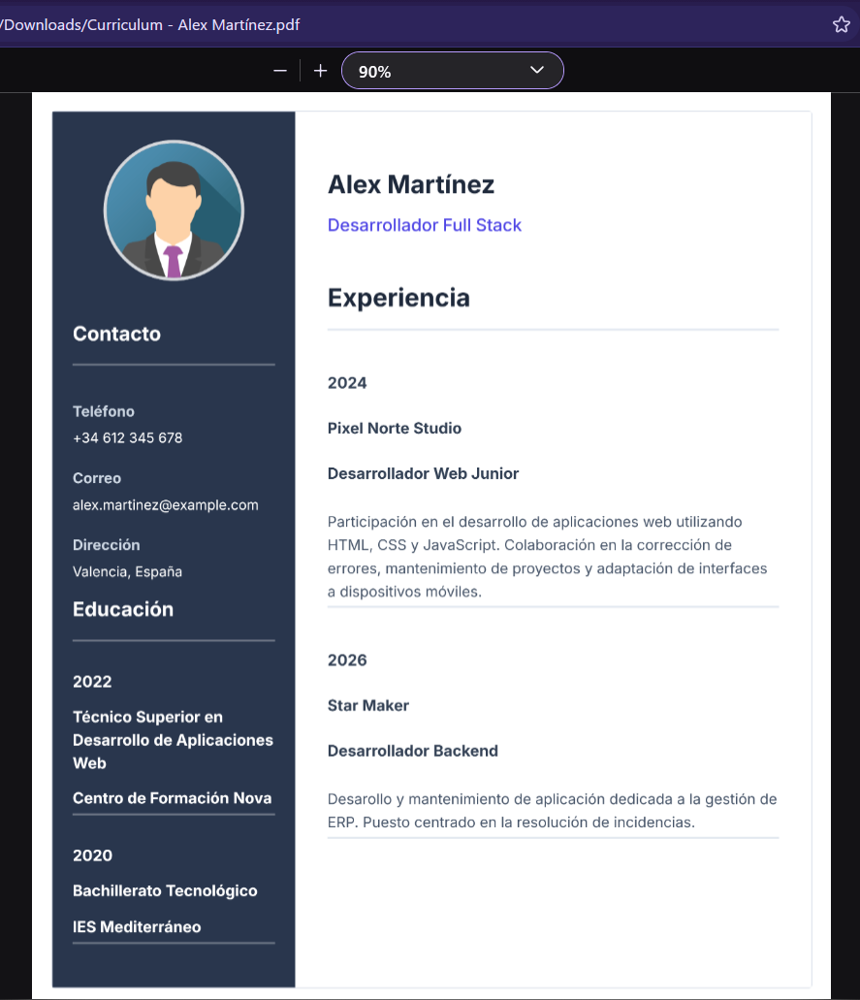

# CV Studio

Aplicación web para crear y personalizar currículums de forma sencilla. Permite introducir información personal, añadir formación académica y experiencia profesional, y visualizar los cambios en tiempo real mientras se construye el documento.

**[Ver aplicación en directo](https://creador-curriculum.netlify.app/)**

## Vista previa





## Características

- **Información personal:** añade y modifica tus datos de contacto y perfil profesional.
- **Formación académica:** incorpora y elimina entradas de educación.
- **Experiencia profesional:** añade y elimina experiencias laborales, incluyendo su descripción.
- **Fotografía de perfil:** selecciona una imagen para personalizar tu currículum.
- **Vista previa en tiempo real:** visualiza el resultado mientras editas la información.
- **Exportación a PDF:** genera y descarga el currículum en formato PDF.

## Tecnologías utilizadas

- [React](https://react.dev/) — Biblioteca para construir la interfaz de usuario.
- [Vite](https://vite.dev/) — Herramienta de desarrollo y construcción.
- JavaScript (ES6+).
- HTML5 y CSS3.
- [html2pdf.js](https://ekoopmans.github.io/html2pdf.js/) — Generación y exportación de documentos PDF.

## Instalación y ejecución

### Requisitos

- Node.js.
- npm.

### Pasos

1. Clona el repositorio:

   ```bash
   git clone https://github.com/Samuel-96/cv-generator
   ```

2. Accede al directorio del proyecto:

   ```bash
   cd cv-generator
   ```

3. Instala las dependencias:

   ```bash
   npm install
   ```

4. Inicia el servidor de desarrollo:

   ```bash
   npm run dev
   ```

5. Abre en el navegador la dirección que muestra Vite en la terminal.

## Scripts disponibles

| Comando | Descripción |
|---|---|
| `npm run dev`  | Inicia el servidor de desarrollo. |
| `npm run build`| Genera la versión de producción. |
| `npm run lint` | Ejecuta ESLint para analizar el código. |

## Objetivo del proyecto

CV Studio es un proyecto personal cuyo objetivo es practicar y profundizar en el desarrollo de interfaces con React, trabajando con componentes, estado, propiedades, formularios y gestión de eventos.

También permite experimentar con herramientas del ecosistema JavaScript y mejorar aspectos como la organización del código, la validación de formularios y la generación de documentos PDF.

## Autor

**Samuel-96**

- GitHub: [Samuel-96](https://github.com/Samuel-96)
